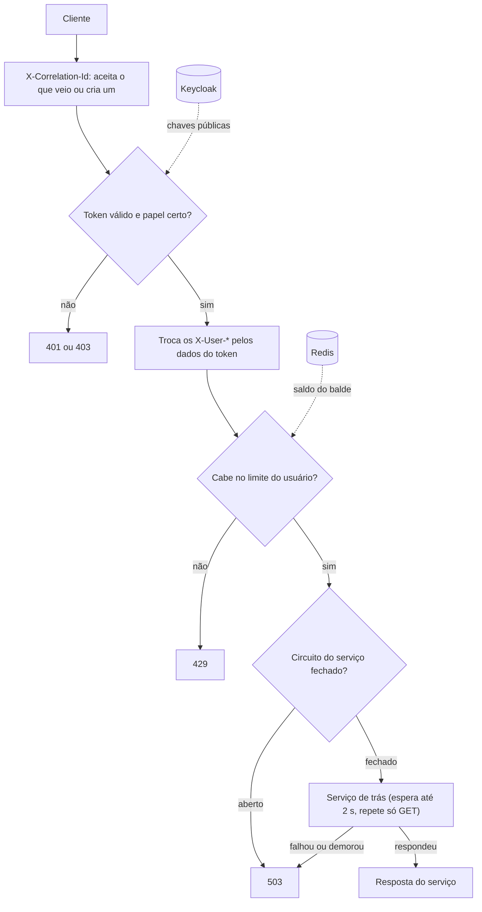

# api-gateway

[](https://github.com/Jhonatas-de-Freitas/api-gateway/actions/workflows/ci.yml)

A porta de entrada de uma loja fictícia. Tudo que vem de fora passa por aqui: o gateway confere o login (JWT do Keycloak), limita abuso (token bucket no Redis), protege contra serviço lento ou fora do ar (circuit breaker) e repassa a chamada para o serviço certo.

Feito com Java 21, Spring Boot 4.1 e Spring Cloud Gateway (WebFlux). Faz parte de um conjunto de cinco projetos; os serviços de trás ficam no [order-platform](https://github.com/Jhonatas-de-Freitas/order-platform). Este repositório roda sozinho: no `docker compose` daqui, um WireMock faz o papel dos serviços.

## Como funciona



O gateway tira o `/api` do caminho e repassa:

| Caminho | Vai para | Quem pode |
|---|---|---|
| `GET /api/products/**` | inventory-service | todos, sem login |
| outros métodos em `/api/products/**` | inventory-service | papel `admin` |
| `/api/reservations/**` | inventory-service | logado |
| `/api/orders/**` | order-service | logado |
| `/api/payments/**` | payment-service | logado |
| `/api/notifications/**`, `/api/preferences/**` | notification-service | logado |
| `/api/analytics/**` | order-analytics | papel `admin` |

Qualquer outro caminho é recusado. Os erros que o próprio gateway responde (`401`, `403`, `429`, `503`) saem em `application/problem+json`, com a mensagem em português, inclusive a recusa de CORS. Cada requisição vira uma linha de log com método, caminho, status, tempo, usuário e correlation id.

## Como rodar

Precisa de Docker.

```bash
docker compose up -d --build --wait
```

| O que sobe | Endereço | Observação |
|---|---|---|
| gateway | http://localhost:8080 | saúde em `/actuator/health`, métricas em `/actuator/prometheus` |
| Keycloak | http://localhost:8180 | realm `store` importado de `docker/keycloak/store-realm.json`; console com `admin` / `admin` |
| Redis | localhost:6379 | guarda o saldo de cada balde |
| WireMock | http://localhost:8089 | respostas de exemplo em `docker/wiremock` |

Usuários de demonstração: `ana` / `demo123` (papel `customer`) e `admin` / `admin123` (papéis `admin` e `customer`).

Para parar e apagar tudo: `docker compose down`.

Endereços dos serviços, limites e tempos são variáveis de ambiente (`ORDER_SERVICE_URL`, `RATE_LIMIT_BURST_CAPACITY`, `SERVICE_TIMEOUT`...). A lista com os valores padrão está em `src/main/resources/application.yml`.

Os testes rodam com `./mvnw verify`. Os de integração sobem Redis e Keycloak com Testcontainers, então também precisam de Docker; sem ele são pulados e rodam só os de unidade.

## Como testar os cenários

Os comandos usam `curl` e `jq`. O script `scripts/smoke-test.sh` faz todos eles de uma vez e confere as respostas; é o que o CI roda.

Pegar um token para cada usuário:

```bash
token() {
  curl -s http://localhost:8180/realms/store/protocol/openid-connect/token \
    -d grant_type=password -d client_id=store-web -d username=$1 -d password=$2 | jq -r .access_token
}
ANA=$(token ana demo123)
ADMIN=$(token admin admin123)
```

Sem login: os produtos são públicos, os pedidos não.

```bash
curl -s http://localhost:8080/api/products | jq '.[].name'
curl -i http://localhost:8080/api/orders        # 401
```

Token que não vale: qualquer coisa que não seja um token assinado pelo Keycloak, dentro da validade, volta `401`.

```bash
curl -i -H "Authorization: Bearer abc" http://localhost:8080/api/orders        # 401
```

Com login e com papel: a Ana lê os pedidos dela, mas só o admin mexe no estoque e vê as métricas.

```bash
curl -s -H "Authorization: Bearer $ANA" http://localhost:8080/api/orders | jq

STOCK=http://localhost:8080/api/products/11111111-1111-1111-1111-111111111111/stock
curl -i -X PUT $STOCK -H "Authorization: Bearer $ANA" -H 'Content-Type: application/json' -d '{"availableQuantity": 50}'     # 403
curl -i -X PUT $STOCK -H "Authorization: Bearer $ADMIN" -H 'Content-Type: application/json' -d '{"availableQuantity": 50}'   # 200

curl -i -H "Authorization: Bearer $ANA" http://localhost:8080/api/analytics/summary      # 403
curl -s -H "Authorization: Bearer $ADMIN" http://localhost:8080/api/analytics/summary | jq
```

Tentar se passar por outra pessoa: mando `X-User-Id` e `X-User-Roles` falsos e depois pergunto ao WireMock o que chegou nele. Chegam o id, o nome, o e-mail e o papel que estão no token da Ana.

```bash
curl -s -o /dev/null http://localhost:8080/api/orders/7c1f0a34-5b1d-4f6e-8a2b-9d3e4f5a6b7c \
  -H "Authorization: Bearer $ANA" -H 'X-User-Id: outra-pessoa' -H 'X-User-Roles: admin'
curl -s http://localhost:8089/__admin/requests | jq '.requests[0].request.headers'
```

CORS: o navegador pergunta antes de chamar de outro endereço. O painel (`http://localhost:5173`) é aceito; outra origem recebe `403`.

```bash
curl -i -X OPTIONS http://localhost:8080/api/orders -H 'Origin: http://localhost:5173' -H 'Access-Control-Request-Method: POST'   # 200
curl -i -X OPTIONS http://localhost:8080/api/orders -H 'Origin: http://localhost:3000' -H 'Access-Control-Request-Method: POST'   # 403
```

Estourar o limite: criar pedido aceita uma rajada de 5 e repõe 2 por segundo. Os primeiros voltam `202`, os seguintes `429`. O último comando, rodado logo em seguida, mostra a resposta recusada com os headers `X-RateLimit-*` e `Retry-After` (se vier `202`, o balde já repôs uma ficha: rode o bloco de novo). O limite é por usuário: troque `$ANA` por `$ADMIN` e o pedido passa.

```bash
ORDER='{"customerId":"c-1001","customerName":"Ana Souza","customerEmail":"ana@exemplo.com","items":[{"productId":"11111111-1111-1111-1111-111111111111","quantity":2}]}'
for i in $(seq 1 15); do
  curl -s -o /dev/null -w '%{http_code} ' -X POST http://localhost:8080/api/orders \
    -H "Authorization: Bearer $ANA" -H 'Content-Type: application/json' -d "$ORDER"
done
curl -i -X POST http://localhost:8080/api/orders -H "Authorization: Bearer $ANA" -H 'Content-Type: application/json' -d "$ORDER"
```

Acompanhar os pedidos por SSE: o exemplo manda 3 eventos, um a cada 2 segundos, e fecha. A conexão dura mais que o limite de 2 s das outras rotas e não é cortada.

```bash
curl -N -H "Authorization: Bearer $ANA" http://localhost:8080/api/orders/stream
```

Derrubar um serviço: com o WireMock parado, o gateway responde `503` sem deixar a chamada pendurada (a espera por um serviço é de no máximo 2 segundos). Depois de 5 chamadas o circuito abre e o `503` sai sem nem tentar o serviço. Com o serviço de volta, o circuito testa de novo em até 10 segundos e as chamadas voltam a passar.

```bash
docker compose stop wiremock
curl -i -H "Authorization: Bearer $ANA" http://localhost:8080/api/payments/7c1f0a34-5b1d-4f6e-8a2b-9d3e4f5a6b7c   # 503
docker compose start wiremock
```

Serviço lento: o exemplo tem um pagamento que demora 5 segundos para responder. O gateway espera 2 e responde `503`.

```bash
curl -i -H "Authorization: Bearer $ANA" http://localhost:8080/api/payments/slow   # 503 depois de 2 s
```

Para ver o log de acesso: `docker compose logs api-gateway | grep access`.

## Decisões que tomei e por quê

**Token bucket no limite de uso.** Uma tela que abre faz várias chamadas de uma vez, e isso não é abuso. O balde deixa passar essa rajada e mesmo assim segura a média: enche a uma taxa fixa e cada requisição gasta uma ficha. Uma janela fixa de contagem deixaria passar o dobro na virada da janela. No Redis o balde são dois valores por chave (fichas e hora da última reposição), atualizados por um script Lua, então várias instâncias do gateway dividem a mesma conta. Uso o `RedisRateLimiter` do Spring Cloud Gateway com um filtro meu na frente, porque o filtro pronto responde `429` sem corpo.

**Limite por usuário, não por IP.** Um escritório inteiro sai pelo mesmo IP: limitar por IP puniria todos por causa de um. E quem quer abusar troca de IP com facilidade, mas não de conta. A chave é o `sub` do token; sem login só resta o IP. São dois baldes por usuário: um geral (20/s, rajada de 40) e um só para criar pedido (2/s, rajada de 5), que é a operação cara, porque dispara reserva de estoque e pagamento. Se o Redis cair, o limite deixa de valer e as requisições passam: preferi ficar sem limite por um tempo a ficar fora do ar.

**O que o circuit breaker protege.** Protege o gateway e quem está chamando. Sem ele, cada chamada para um serviço parado esperaria o tempo limite inteiro, segurando conexão. Com ele, depois de 5 chamadas com metade falhando, o gateway responde `503` na hora por 10 segundos e então deixa passar 2 chamadas de teste. Cada serviço tem o seu circuito: o pagamento fora do ar não derruba a lista de produtos. Só `GET` é repetido (2 vezes), porque repetir um `POST` pode criar dois pedidos. A rota de SSE fica fora do circuito: o tempo limite conta até a resposta começar, e um stream pode ficar calado até o primeiro evento.

**Por que remover os headers que vêm de fora.** Os serviços de trás confiam em `X-User-Id` e `X-User-Roles` para saber quem está chamando. Se o gateway só repassasse o que recebe, bastaria escrever `X-User-Roles: admin` no `curl`. Por isso ele sempre apaga esses headers e recria a partir do token já validado, inclusive nas rotas públicas. Tem um caminho menos óbvio para o mesmo ataque: o header `Connection` serve para listar headers que valem só até o próximo salto, e o gateway remove os listados antes de repassar. Quem chama podia escrever `Connection: X-User-Id` e fazer o gateway apagar o header que ele mesmo tinha acabado de escrever. Então o `Connection` é resolvido logo na entrada, antes de o gateway acrescentar qualquer coisa.

**O emissor do token.** O token diz quem o emitiu no campo `iss`, e o gateway só aceita `http://localhost:8180/realms/store`, que é o endereço que o navegador usa. Só que dentro do Docker o gateway não alcança o Keycloak por `localhost:8180`; alcança por `keycloak:8080`. Resolvi nos dois lados. No Keycloak, `KC_HOSTNAME=http://localhost:8180` fixa o emissor, venha o pedido de onde vier, e `KC_HOSTNAME_BACKCHANNEL_DYNAMIC=true` mantém o acesso pelo nome interno. No gateway, `jwk-set-uri` aponta para `keycloak:8080` para buscar as chaves da assinatura e `issuer-uri` serve só para comparar com o `iss`. Com os dois configurados o Spring não tenta abrir o endereço do emissor ao subir. O `KeycloakIT` prova essa combinação com um Keycloak de verdade em porta aleatória.

**As chaves do Keycloak ficam em memória.** O gateway baixa as chaves públicas uma vez e guarda. Um token com um `kid` que ele não conhece pode ser sinal de troca de chave, então ele baixa de novo, mas no máximo uma vez a cada 30 segundos. O decodificador padrão do Spring baixa a cada `kid` desconhecido, e aí cada requisição com um `kid` inventado vira uma chamada ao Keycloak. Também exijo `exp` e `sub`: o validador padrão só confere a validade quando o token traz a data.

**Fechado por padrão.** O que não está na tabela de rotas é negado, e a rota interna de fallback não pode ser chamada de fora. Rota nova precisa de regra de acesso escrita.

## O que eu faria a seguir

- Validar a audiência (`aud`) do token. O realm de exemplo não emite essa claim; eu criaria um mapper no Keycloak e passaria a exigir.
- Atrás de um balanceador, tirar o IP do cliente do `X-Forwarded-For` de um proxy confiável. Hoje o limite sem login usa o endereço da conexão.
- Um limite local, em memória, para quando o Redis estiver fora, em vez de liberar tudo.
- Limitar por IP as chamadas recusadas com `401`. Hoje o limite roda depois do login, então quem insiste com token errado nunca recebe `429`.
- Servir o Actuator em outra porta, só na rede interna. Hoje as métricas saem na porta pública; tirei delas os endereços dos serviços e do Redis, mas o volume por rota continua à vista.
- Trace distribuído com OpenTelemetry. O correlation id já junta os logs, mas não mostra onde o tempo foi gasto.
- Juntar no gateway a documentação OpenAPI dos serviços de trás, numa página só.
